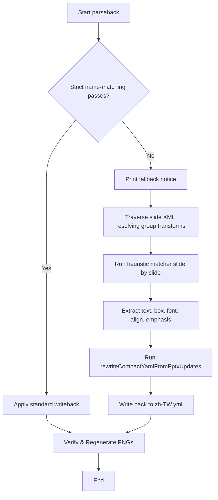

# Design Spec: Legacy PPTX Parser & Heuristic Writeback

**Date:** 2026-07-07  
**Author:** Antigravity (AI Coding Assistant)  
**Status:** Draft / Awaiting Review  

---

## 1. Context & Goals

Audrey's desktop editable PowerPoint file `/Users/au/Desktop/zh-TW-editable.pptx` contains translation edits and layout adjustments. However, it was edited and saved using Apple Keynote, which strips original slide shape names (such as `b001_title`, `b002_body`, etc.) and groups shapes into nested `p:grpSp` elements. 

The existing `parseback` utility in `scripts/zh_tw_comics_pipeline.ts` relies on strict name matching to map shapes back to `translation-assets/zh-TW.yml` and fails when these shape names are missing or renamed.

### Goals
- Resolve nested group transformations (`p:grpSp`) in the slide OOXML to retrieve absolute shape positions.
- Implement a heuristic matcher that maps PPTX shapes to YAML boxes by combining text similarity and spatial coordinates.
- Support full writeback of text edits, bold/color emphasis styles, font sizes, alignments, and box coordinates back to the YAML.
- Regenerate print/web PNGs from the updated YAML and verify they match the oracle images in `/Users/au/Desktop/zh-TW-editable/`.

---

## 2. Technical Architecture

### 2.1 Group Transform Resolution
PowerPoint group shapes (`p:grpSp`) define nested coordinate systems. A child shape's offset and extent are defined relative to the immediate parent's child coordinate space. 

To resolve the absolute slide coordinates (in EMUs), we maintain a transform stack during recursive XML traversal. For each group transform node, we extract:
- `goff` (group absolute offset `x`, `y`)
- `gext` (group absolute extent `cx`, `cy`)
- `gchoff` (group child offset `x`, `y`)
- `gchext` (group child extent `cx`, `cy`)

For a shape at local coordinates $(cx_0, cy_0)$ with size $(ccx, ccy)$ inside a stack of group transforms, we compute:
- **Absolute Offset:**
  $$ax = goffX + (cx_0 - gchoffX) \times \frac{gextX}{gchextX}$$
  $$ay = goffY + (cy_0 - gchoffY) \times \frac{gextY}{gchextY}$$
- **Absolute Extent:**
  $$aw = ccx \times \frac{gextX}{gchextX}$$
  $$ah = ccy \times \frac{gextY}{gchextY}$$

These resolved absolute coordinates are then converted to render pixels:
$$\text{px} = \frac{\text{emu}}{\text{PPTX\_EMU\_PER\_RENDER\_PX}}$$

### 2.2 Heuristic Matcher
Within each page/slide, shapes from the PPTX are matched to boxes from the YAML using a scoring model:
$$\text{Score} = \text{TextScore} + (\text{IoU} \times 100) - (\text{CenterDistance} \times 0.1)$$

Where:
- **TextScore:** 
  - $+2000$ points if the normalized text matches exactly.
  - $+1000$ points if one normalized text string contains the other.
  - Normalized text is obtained by stripping all whitespace, newlines, and CJK punctuation (`，。？！、：`).
- **IoU (Intersection over Union):**
  - Measures the spatial overlap of the bounding boxes (range $0.0$ to $1.0$).
- **CenterDistance:**
  - Euclidean distance between bounding box centers, which penalizes matching far-away boxes (e.g. slashes or decorative text).

We establish a 1-to-1 matching using a greedy matching algorithm:
1. Sort candidate pairs by score descending.
2. Accept the highest-scoring pairs.
3. Remove mapped shapes/boxes from the candidate pool.

Unmatched shapes in the slide (e.g. decorative slashes or isolated letters) are ignored.

### 2.3 Writeback Integration
The parser returns updates as a Map of `${pageId}/${boxId}` to `ParsedPptxShape`. This matches the interface expected by `rewriteCompactYamlFromPptxUpdates`, allowing in-place updating of the YAML lines while preserving all original document formats.

---

## 3. CLI Interfaces & Flow

We will extend the `parseback` command to support an optional `--legacy` flag or automatically fall back to legacy parsing if strict name matching fails:

```bash
bun scripts/zh_tw_comics_pipeline.ts parseback <pptxPath> [yamlPath]
```

### Flow Diagram


---

## 4. Testing & Verification

1. **Unit Tests:** Add tests to `tests/zh_tw_comics_pipeline.test.ts` to exercise:
   - Nested transform resolution on synthetic grouped shape XML.
   - Heuristic matcher scoring and 1-to-1 matching under edits.
2. **Integration Verification:**
   - Run `bun run zh:tw:parseback /Users/au/Desktop/zh-TW-editable.pptx`.
   - Re-render the pages with `bun run zh:tw:build`.
   - Verify that the generated PNGs match the oracle PNGs at `/Users/au/Desktop/zh-TW-editable/` visually (can be checked via `bun test` and pixel bounds/contrast diagnostics).
